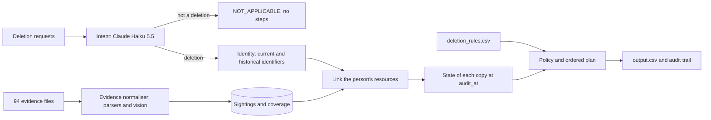

# GhostAudit (HackerRank Orchestrate, October 2026)

- Built for HackerRank Orchestrate (October 2026): final score 67.5/100, rank #425 of 4,090 (top 11%).
- Challenge and dataset: https://github.com/interviewstreet/hackerrank-orchestrate-october26. The dataset isn't included here; to run the agent, copy that repo's dataset/ folder into this repo's root.
- Licence: all rights reserved, published for review.

Northstar's deletion workflow reports "Complete" even when copies of a customer survive in replicas, logs, exports, search indexes and backups. This agent doesn't trust that claim. For every request it checks whether deletion was actually requested, works out who the person is (including old emails and phones), finds every copy of their data across 94 evidence files, works out the state of each copy at the audit time, and applies the deletion policy. The output is a verdict and an ordered, evidence-cited plan of findings, remediation and verification steps.

**Design principle: models read, code judges.** A language model does only what needs reading: understanding requests in any language, and reading screenshots. Deterministic code applies the policy, so the same input always gives the same verdict, and every step can be traced to the evidence that proves it.

## Results

On the 32 labelled sample cases (our development set, so these numbers are optimistic; see the evaluation report):

| | Trust the workflow (baseline) | This agent |
|---|---|---|
| Status correct | 17/32 (53.1%) | 32/32 |
| Step precision / recall | – | 97.3% / 91.7% |
| Exact step sequences | 0/32 | 17/32 |

On the 518 evaluation requests, the workflow reported 254 deletions as COMPLETE. Our audit confirms only 87 of them (34.3%).

The intent model scores 10/10 on our multilingual probes, against 7/10 for keyword rules. All 10 of its "not a deletion" verdicts on the evaluation set agree with an independent signal in the data that it never sees. A full run from an empty cache costs under 5 cents in API calls. A fresh run from an empty cache reproduces `output.csv` byte-for-byte. So does a clean virtual environment built from `requirements.txt`.

Full metrics, custom test cases, label-free checks, failures and limitations: [`code/evaluation/evaluation_report.md`](code/evaluation/evaluation_report.md). Token usage and cost: [`code/evaluation/usage_report.md`](code/evaluation/usage_report.md). Every design decision, with its reason: [`code/DECISIONS.md`](code/DECISIONS.md).

## How it works



1. **Intent.** Each request is classified in its own cached LLM call, so a hostile request text can only ever affect its own verdict.
2. **Identity.** The request email is resolved through current and historical emails, phones and email hashes. Matching is exact, never by name.
3. **Evidence.** JSON exports, SQLite dumps, several log formats, text, PDFs and screenshots are normalised into one table of sightings. A snapshot that lists a system's full contents also proves absence by omission.
4. **State.** The latest admissible evidence inside the audit window decides each copy's state. Replicas are separate copies, and a direct observation beats omission.
5. **Policy and plan.** `deletion_rules.csv` is applied as data. Steps are ordered as the contract requires, and each one cites its evidence.

## Setup and run

Requires Python 3.10+ (tested on 3.10 and 3.12). Run everything from the repository root.

```bash
python3 -m venv .venv && source .venv/bin/activate
pip install -r requirements.txt
echo "ANTHROPIC_API_KEY=your-key" > .env      # only needed when the cache is missing

python3 code/main.py                         # writes output.csv (518 rows)
python3 code/validate.py                     # checks the output contract
python3 code/evaluation/main.py              # scores against the 32 labelled samples
python3 code/main.py --explain case_05       # full audit trail for one case
python3 code/evaluation/build_reports.py     # regenerates both reports
python3 -m unittest discover -s code/tests -v   # offline unit tests: no API key, no network, a few seconds
```

LLM results are cached in `code/cache/`. With the cache present, a run makes no API calls and needs no key. Without a cache or key, `main.py` refuses to write output rather than silently falling back to keyword rules. The flags `--allow-keyword-fallback` and `--allow-missing-vision` force a degraded run if you need one. Every API call is logged to a usage ledger and stops at a spend cap ($1 by default).

## Project structure

| Path | Purpose |
|---|---|
| `code/main.py` | Entry point: runs the audit and writes `output.csv` |
| `code/agent.py` | Case engine: linking, state, policy, ordered steps, audit trail |
| `code/evidence.py` | Normalises every evidence file into sightings and coverage |
| `code/identity.py` | Current and historical identity resolution |
| `code/intent.py`, `code/vision.py` | The two LLM tasks, with their prompts |
| `code/workflow_links.py` | Links primary accounts through the deletion worker's activity |
| `code/llm.py` | The only module that calls the API: cache, usage ledger, spend cap |
| `code/validate.py` | Output contract validator |
| `code/tests/` | Offline unit tests: output validator, step order, identity, fail-loud guards, evidence security, one end-to-end case |
| `code/evaluation/` | Scorer, custom and label-free checks, report builder, reports, metric history |
| `code/DECISIONS.md` | Every design decision and why |

## How it was built

Planning ran in a Claude chat (Opus 5.5). There, I analysed the dataset and tested rules against the gold samples with throwaway prototypes before any code was written. Implementation ran in Claude Code (Sonnet 5.5 for routine work, Opus 5.5 for core logic), from specification prompts that state why each change is needed. The scorer existed before the agent did, and every milestone's metrics are saved in `code/evaluation/history/`. Every Claude Code turn is logged in `log.txt`.
